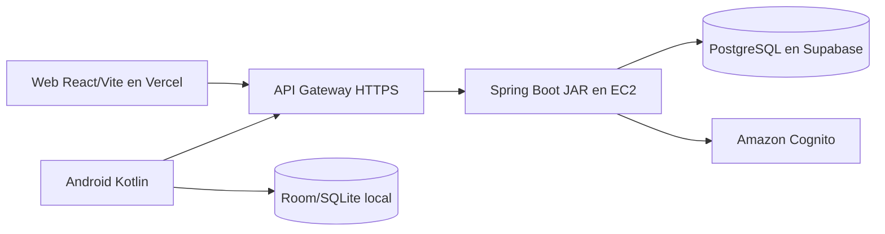

# Arquitectura implementada de SyncPass

## Componentes

La web usa React, Vite, componentes JSX, rutas Wouter y CSS propio. El móvil es Kotlin con Jetpack Compose. Ambos consumen la API REST de Spring Boot. El backend usa JWT/Cognito para identidad y roles, JPA para datos y Flyway para migraciones. PostgreSQL está en Supabase; Room/SQLite conserva operaciones locales del móvil.

## Flujos para demostrar

1. Usuario inicia sesión en web o Android; la API valida las credenciales con Cognito y entrega la sesión.
2. El frontend adjunta el token al consumir los endpoints protegidos.
3. Administrador o coordinador ejecuta CRUD de talleres y proyectos comunitarios mediante la API.
4. El móvil guarda borradores locales y los sincroniza cuando hay conectividad, según las funciones implementadas.

## Despliegue y límites

Vercel sirve el frontend. API Gateway publica HTTPS hacia EC2, donde corre el JAR. EC2 está dentro de la VPC del laboratorio. La API y la web dependen de que el laboratorio permanezca activo. QR, GPS y operación completa en nube son objetivos de la tercera evaluación; no se presentan como terminados en la demostración del viernes.

La implementación actual usa JSX y CSS propio. TypeScript y Tailwind no están integrados: se pueden explicar como tecnologías propuestas, sin atribuirles código existente.
