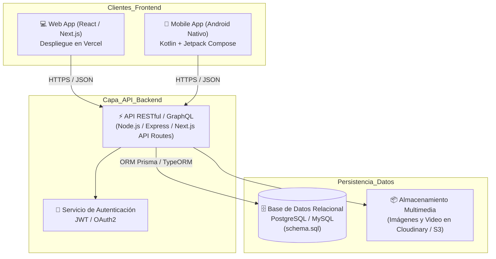

# Arquitectura del Sistema: Full Stack (React + Vercel) y Móvil (Kotlin Android)

**Asignatura:** DSY1104 - Desarrollo Fullstack II (Duoc UC)
**Proyecto:** E&J Proyectos Web
**Estado:** Especificación y Diseño Arquitectónico (sin codificación backend/mobile en esta fase)

---

## 1. Visión General de la Arquitectura

Para la evolución del proyecto actual (HTML5, Bulma, JavaScript plano) hacia un ecosistema moderno multiplataforma, se define una arquitectura basada en **servicios desacoplados** donde tanto la aplicación web como la aplicación móvil consumen la misma lógica de negocio y persistencia.



---

## 2. Plataforma Web: React + Vercel

### 2.1 Mapeo de Páginas Actuales a Componentes React

| Archivo Actual | Componente React | Responsabilidad |
| :--- | :--- | :--- |
| `index.html` | `<HomePage />` | Renderiza el banner hero, cuadrícula de beneficios, listado de proyectos y reproductor de video. |
| `login.html` | `<LoginPage />` | Formulario controlado con hook `useForm` o React Hook Form; validaciones y despacho de token JWT. |
| `register.html` | `<RegisterPage />` | Registro de clientes con validación reactiva de contraseñas y conexión a API. |
| `mockups.html` | `<MockupViewer />` | Módulo de presentación interactivo para revisiones docentes y testing de UI. |
| `css/estilos.css` | Módulos CSS / Bulma / Tailwind | Estilos encapsulados con diseño responsive para escritorio, tablet y móvil. |

### 2.2 Despliegue en Vercel
- **Integración Continua (CI/CD):** Cada commit en la rama `main` o `developer` dispara un despliegue automático con URL de vista previa.
- **Configuración de `vercel.json` proyectada:**
```json
{
  "buildCommand": "npm run build",
  "outputDirectory": "dist",
  "rewrites": [
    { "source": "/(.*)", "destination": "/index.html" }
  ]
}
```

---

## 3. Plataforma Móvil: Android Nativo con Kotlin (Jetpack Compose)

### 3.1 Estructura del Proyecto Kotlin (Arquitectura MVVM)

```text
app/src/main/java/cl/duoc/eyjproyectos/
├── data/
│   ├── api/
│   │   ├── ApiService.kt            # Definición Retrofit de endpoints
│   │   └── RetrofitClient.kt
│   ├── model/
│   │   ├── Proyecto.kt              # Data class para catálogo
│   │   ├── Usuario.kt               # Data class para perfil/auth
│   │   └── Pedido.kt
│   └── repository/
│       ├── ProyectoRepository.kt
│       └── AuthRepository.kt
├── ui/
│   ├── navigation/
│   │   ├── AppNavigation.kt         # NavHost y rutas de Compose
│   │   └── Screen.kt                # Sealed class con rutas (Home, Login, Register...)
│   ├── screens/
│   │   ├── home/HomeScreen.kt
│   │   ├── login/LoginScreen.kt
│   │   ├── register/RegisterScreen.kt
│   │   ├── detail/ProjectDetailScreen.kt
│   │   └── checkout/CheckoutScreen.kt
│   ├── viewmodel/
│   │   ├── HomeViewModel.kt         # StateFlow para listado de proyectos
│   │   └── AuthViewModel.kt         # Gestión de estados de login y registro
│   └── theme/
│       ├── Color.kt                 # Azul corporativo #2452c9 y acentos
│       └── Theme.kt
```

### 3.2 Equivalencias de Componentes (HTML/Bulma vs. Kotlin Compose)

| Elemento Web (HTML + Bulma) | Equivalente Kotlin en Jetpack Compose |
| :--- | :--- |
| `<header>` + `<nav>` | `TopAppBar` o `Scaffold(topBar = { ... })` |
| `<div class="proyectos">` | `LazyColumn` o `LazyVerticalGrid(columns = GridCells.Fixed(2))` |
| `<article class="card">` | `Card(elevation = CardDefaults.cardElevation(defaultElevation = 4.dp))` |
| `<input class="input" type="email">` | `OutlinedTextField(value = email, onValueChange = { ... }, label = { Text("Correo") })` |
| `<button class="button is-link">` | `Button(onClick = { ... }, colors = ButtonDefaults.buttonColors(...))` |
| `<video controls>` | `AndroidView` envolviendo un `PlayerView` de **ExoPlayer (Media3)** |
| `<footer>` | `BottomAppBar` o `NavigationBar` con items de navegación |

### 3.3 Dependencias Principales en `build.gradle.kts` (Referencia)

```kotlin
dependencies {
    // Jetpack Compose BOM
    implementation(platform("androidx.compose:compose-bom:2024.09.00"))
    implementation("androidx.compose.ui:ui")
    implementation("androidx.compose.material3:material3")
    implementation("androidx.navigation:navigation-compose:2.8.0")

    // ViewModel y Ciclo de Vida
    implementation("androidx.lifecycle:lifecycle-viewmodel-compose:2.8.5")

    // Consumo de API REST (Retrofit + Moshi / Kotlinx Serialization)
    implementation("com.squareup.retrofit2:retrofit:2.11.0")
    implementation("com.squareup.retrofit2:converter-gson:2.11.0")

    // Carga de imágenes asíncronas
    implementation("io.coil-kt:coil-compose:2.7.0")

    // Reproducción de video nativo
    implementation("androidx.media3:media3-exoplayer:1.4.1")
    implementation("androidx.media3:media3-ui:1.4.1")
}
```

---

## 4. Estrategia de Migración Progresiva

1. **Fase 1 (Actual - Evaluación Parcial 1):**
   - Frontend estático con HTML5 semántico, Bulma CSS local y validaciones en JavaScript.
   - Definición del modelo de base de datos (`docs/MODELO_BASE_DATOS.md` y `database/schema.sql`).
   - Mockups detallados de todas las vistas Web y Móvil (`docs/MOCKUPS.md` y `mockups.html`).
   - Scripts de automatización y clonación (`clonar.bat`, `clonar.ps1`, `clonar.sh`).

2. **Fase 2 (Siguiente etapa semestral):**
   - Migración del frontend a componentes React (Next.js) y despliegue continuo en Vercel.
   - Conexión de los formularios de Login y Registro al servicio de autenticación.

3. **Fase 3 (Plataforma Móvil Android):**
   - Implementación de la aplicación en Kotlin con Jetpack Compose consumiendo los endpoints REST.
   - Almacenamiento seguro de tokens con EncryptedSharedPreferences / DataStore.
