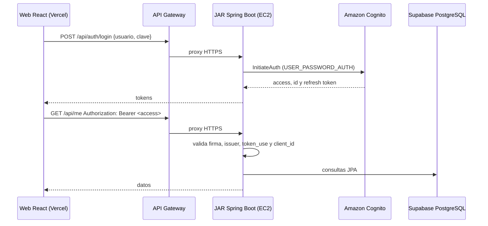

# Autenticación con Amazon Cognito a través de la API

SyncPass **no llama a Cognito desde el navegador**. El registro, la confirmación del
correo y el inicio de sesión son endpoints de la API Java que corre en EC2; es esa API
la que habla con Cognito. Así queda demostrado que la web consume la infraestructura
propia (API Gateway → EC2) y no un servicio externo de forma directa.

## Datos del user pool

| Elemento | Valor |
| --- | --- |
| Región | `us-east-1` |
| User pool | `us-east-1_2C9bbmKGd` |
| Cliente de la app (público, sin secreto) | `677bhbj1qg892bmlk2pr1h6had` |
| Grupos (roles) | `admin`, `coordinador`, `monitor`, `participante` |

> [!IMPORTANT]
> En **Cognito → User pool → App clients → `677bhbj1…` → Edit → Authentication flows**
> debe estar marcado **`ALLOW_USER_PASSWORD_AUTH`** (además de `ALLOW_REFRESH_TOKEN_AUTH`).
> Sin ese flujo, `/api/auth/login` responde `400 INVALID_PARAMETER`.

## Endpoints de autenticación

Todos son `POST`, públicos y reciben JSON. Los errores devuelven `{ "code", "message" }`.

| Endpoint | Cuerpo | Respuesta | Operación en Cognito |
| --- | --- | --- | --- |
| `/api/auth/register` | `username`, `email`, `nickname`, `password` | `201` `{ userConfirmed, destination }` | `SignUp` |
| `/api/auth/confirm` | `username`, `code` | `204` | `ConfirmSignUp` |
| `/api/auth/resend` | `username` | `204` | `ResendConfirmationCode` |
| `/api/auth/login` | `username`, `password` | `200` `{ accessToken, idToken, refreshToken, expiresIn }` | `InitiateAuth` |
| `/api/auth/refresh` | `refreshToken` | `200` (mismos campos) | `InitiateAuth` (`REFRESH_TOKEN_AUTH`) |
| `/api/auth/logout` | `refreshToken` | `204` | `RevokeToken` |

| Código | Cuándo |
| --- | --- |
| `400 VALIDATION` | Campo vacío, correo inválido o clave de menos de 8 caracteres (no llega a Cognito) |
| `400 INVALID_PASSWORD` | La clave no cumple la política del pool |
| `400 CODE_MISMATCH` / `CODE_EXPIRED` | Código de verificación incorrecto o vencido |
| `401 NOT_AUTHORIZED` | Usuario o clave incorrectos. Es igual exista o no el usuario, para no revelar cuentas |
| `403 USER_NOT_CONFIRMED` | Falta confirmar el correo |
| `409 USERNAME_EXISTS` | El usuario ya está registrado |
| `429 TOO_MANY_REQUESTS` | Cognito limitó los intentos |

## Buenas prácticas aplicadas

- **Sin credenciales IAM en EC2.** `SignUp`, `ConfirmSignUp`, `InitiateAuth` y
  `RevokeToken` son operaciones públicas del cliente de la app; el SDK usa credenciales
  anónimas. No hay llaves que expiren con el laboratorio ni que se puedan filtrar.
- **Sin secretos en el frontend.** La web solo conoce `VITE_API_URL`.
- **Validación en dos capas.** Bean Validation rechaza datos mal formados antes de
  llamar a Cognito; Cognito aplica la política de contraseñas.
- **La autorización real está en la API.** Cada ruta protegida valida firma (JWKS),
  `issuer`, vencimiento, `token_use=access` y `client_id`. Los roles salen de
  `cognito:groups`. La web solo oculta botones.
- **Sesión acotada.** Los tokens viven en `sessionStorage` (se borran al cerrar la
  pestaña), se renuevan con el refresh token antes de vencer y el cierre de sesión
  revoca el refresh token en Cognito.
- **Mensajes que no filtran información.** Usuario inexistente y clave incorrecta
  responden lo mismo.
- **Transporte cifrado.** Navegador → API Gateway → Caddy en EC2, todo HTTPS; el
  puerto 8080 solo escucha en `127.0.0.1`.

## Roles

Un usuario recién registrado no pertenece a ningún grupo: puede iniciar sesión y ver
su perfil, pero no crear talleres. Para darle permisos se agrega al grupo en
**Cognito → Users → usuario → Add user to group** y se vuelve a iniciar sesión.

## Android

La app móvil usa su propio cliente público (`6166ssk62lsbrqv7i98tk08htc`) con callback
`cl.duoc.syncpass://cognito/callback`. Referencia de clase:
[Integración Cognito con Web App y Mobile](https://www.youtube.com/watch?v=_E0L5mn-sTM).
