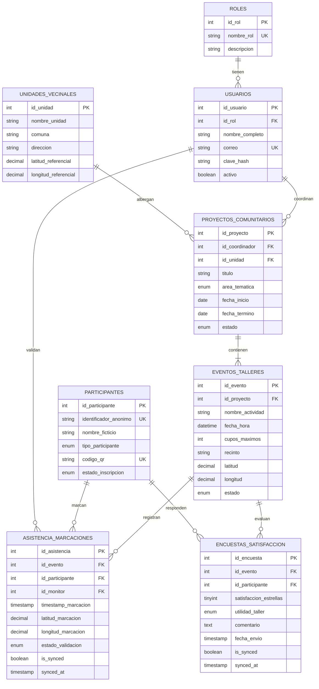

# Modelo de Base de Datos Transaccional (OLTP): Sistema SyncPass

**Asignatura:** DSY1105 (Desarrollo de Aplicaciones Móviles) / DSY1104 (Full Stack)
**Institución:** Duoc UC · CITT Plaza Vespucio
**Socio Formador:** TI CONSULTING DIEGO GARCÉS MIRANDA E.I.R.L. (Ticdgm)
**Proyecto:** SyncPass — Acreditación QR, Encuestas y Modo Offline-First

---

## 1. Justificación y Alcance del Caso

El sistema resuelve la problemática de acreditación de asistencia en terreno para actividades comunitarias y de vinculación con el medio:
- **Lectura de códigos QR en menos de 5 segundos**, reemplazando las planillas de papel impresas.
- **Arquitectura Offline-First:** Los registros de asistencia y encuestas se guardan de inmediato en la base de datos local (Room / SQLite) con la bandera `is_synced = FALSE`. Cuando el dispositivo detecta conexión a internet, se ejecuta un *Batch Sync* contra la API REST central.
- **Encuestas de satisfacción instantáneas (1 a 5 estrellas Likert):** Levantadas in situ para alcanzar más del 65% de tasa de respuesta efectiva.
- **Datos 100% simulados y anonimizados**, cumpliendo estrictamente con la restricción 5.1 del caso.

---

## 2. Diagrama Entidad-Relación (Modelo ER Transaccional)

---

## 3. Diccionario de Datos

### Tabla: `unidades_vecinales`
| Campo | Tipo | Nulo | Clave | Descripción |
| :--- | :--- | :--- | :--- | :--- |
| `id_unidad` | INT | NO | PK (Auto) | Identificador único de la sede comunitaria |
| `nombre_unidad` | VARCHAR(120) | NO | | Nombre formal (ej: 'Unidad Vecinal N° 12') |
| `comuna` | VARCHAR(80) | NO | | Comuna (La Florida, Puente Alto, La Granja) |
| `latitud_referencial` | DECIMAL(10,7)| NO | | Coordenada GPS de control territorial |
| `longitud_referencial`| DECIMAL(10,7)| NO | | Coordenada GPS de control territorial |

### Tabla: `asistencia_marcaciones` (Eje del Modo Offline-First)
| Campo | Tipo | Nulo | Clave | Descripción |
| :--- | :--- | :--- | :--- | :--- |
| `id_asistencia` | INT | NO | PK (Auto) | Identificador local/remoto de marcación |
| `id_evento` | INT | NO | FK | Taller en ejecución (FK -> eventos_talleres) |
| `id_participante` | INT | NO | FK | Beneficiario acreditado (FK -> participantes)|
| `id_monitor` | INT | NO | FK | Estudiante voluntario que escanea el QR |
| `timestamp_marcacion` | TIMESTAMP | NO | DEFAULT NOW | Marca de tiempo exacta del escaneo |
| `estado_validacion` | ENUM | NO | DEFAULT 'valido'| 'valido', 'fuera_de_rango', 'duplicado' |
| `is_synced` | BOOLEAN | NO | DEFAULT FALSE | **FALSE = Guardado en SQLite/Room; TRUE = Sincronizado** |
| `synced_at` | TIMESTAMP | SÍ | | Momento en que la API central confirmó la subida |

### Tabla: `encuestas_satisfaccion`
| Campo | Tipo | Nulo | Clave | Descripción |
| :--- | :--- | :--- | :--- | :--- |
| `id_encuesta` | INT | NO | PK (Auto) | Identificador único de la encuesta |
| `id_evento` | INT | NO | FK | Evento evaluado |
| `id_participante` | INT | NO | FK | Asistente que califica |
| `satisfaccion_estrellas`| TINYINT | NO | CHECK 1..5 | Escala de 1 a 5 estrellas Likert |
| `utilidad_taller` | ENUM | NO | | 'muy_util', 'util', 'regular', 'poco_util' |
| `is_synced` | BOOLEAN | NO | DEFAULT FALSE | Bandera para envío diferido offline |
