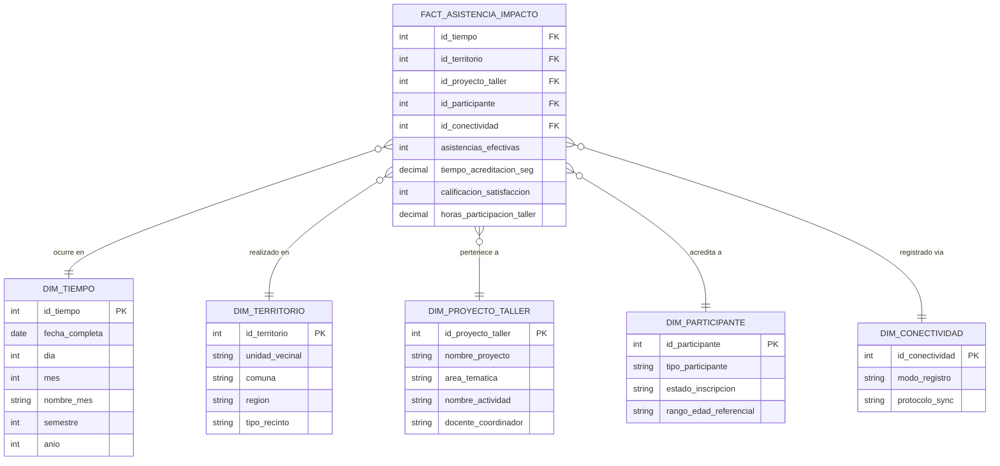

# Modelos Multidimensionales: Estrella y Copo de Nieve — SyncPass

**Asignatura:** DSY1105 / DSY1104 · Duoc UC CITT Plaza Vespucio
**Caso:** SyncPass (TI CONSULTING DIEGO GARCÉS MIRANDA E.I.R.L.)
**Ámbito:** Data Warehouse de Acreditación, Asistencia y Reportabilidad de Impacto Comunitario

---

## 1. Justificación y Propósito Analítico

Para responder a las exigencias de acreditación y reportabilidad de **Vinculación con el Medio (VCM)** de Duoc UC, la dirección y los docentes coordinadores necesitan responder:
- *¿Cuál es el quórum efectivo y la tasa de asistencia por taller y unidad vecinal?*
- *¿Cuál es el tiempo promedio de acreditación por QR frente al método manual de papel?*
- *¿Qué nivel de satisfacción promedio se obtuvo en talleres de 'Tecnología' vs. 'Emprendimiento'?*
- *¿Cuántos registros se capturaron en modo Offline versus Online?*

Para ello se definen el **Modelo en Estrella (Star Schema)** y el **Modelo en Copo de Nieve (Snowflake Schema)**.

---

## 2. Modelo en Estrella (Star Schema)

En este modelo, la tabla de hechos central **`FACT_ASISTENCIA_IMPACTO`** contiene las métricas agregables y se conecta a dimensiones desnormalizadas.

### 2.1 Esquema Visual del Modelo Estrella

```text
               +---------------------------+
               |        DIM_TIEMPO         |
               +---------------------------+
               | PK  id_tiempo (AAAAMMDD)  |
               |     fecha_completa        |
               |     dia, mes, nombre_mes  |
               |     semestre (1 o 2)      |
               |     anio (2026)           |
               +-------------+-------------+
                             |
                             | 1:N
                             v
+------------------+   +-------------------------------+   +--------------------+
|  DIM_TERRITORIO  |   |    FACT_ASISTENCIA_IMPACTO    |   |DIM_PROYECTO_TALLER |
+------------------+   +-------------------------------+   +--------------------+
| PK id_territorio |--->| PK/FK id_tiempo              |<---| PK id_proy_taller  |
|    unidad_vecinal|   | PK/FK id_territorio           |   |    nombre_proyecto |
|    comuna        |   | PK/FK id_proyecto_taller      |   |    area_tematica   |
|    region        |   | PK/FK id_participante         |   |    nombre_taller   |
|    tipo_recinto  |   | PK/FK id_conectividad         |   |    docente_lider   |
+------------------+   | ----------------------------- |   +--------------------+
                       | 📊 asistencias_efectivas      |
                       | 📊 tiempo_acreditacion_seg    |
                       | 📊 calificacion_satisfaccion  |
                       | 📊 horas_participacion_taller |
                       +---------------+---------------+
                                       ^
                                       | 1:N
               +-----------------------+-----------------------+
               |                                               |
+--------------+-------------+                   +-------------+-------------+
|      DIM_PARTICIPANTE      |                   |      DIM_CONECTIVIDAD     |
+----------------------------+                   +---------------------------+
| PK  id_participante        |                   | PK  id_conectividad       |
|     tipo_participante      |                   |     modo_registro         |
|     estado_inscripcion     |                   |     (Offline / Online)    |
|     rango_edad_referencial |                   |     protocolo_sync        |
+----------------------------+                   +---------------------------+
```

### 2.2 Diagrama Mermaid del Modelo Estrella



---

## 3. Modelo en Copo de Nieve (Snowflake Schema)

El modelo en copo de nieve normaliza las dimensiones jerárquicas:
1. **Jerarquía Territorial:** `DIM_TERRITORIO` $\rightarrow$ `DIM_COMUNA` $\rightarrow$ `DIM_REGION`.
2. **Jerarquía Académica:** `DIM_TALLER` $\rightarrow$ `DIM_PROYECTO` $\rightarrow$ `DIM_AREA_TEMATICA`.
3. **Jerarquía Temporal:** `DIM_TIEMPO` $\rightarrow$ `DIM_MES` $\rightarrow$ `DIM_SEMESTRE` $\rightarrow$ `DIM_ANIO`.

### 3.1 Esquema Visual del Copo de Nieve

```text
       +---------------+     +-----------------+     +---------------+
       |   DIM_ANIO    |     |  DIM_SEMESTRE   |     |    DIM_MES    |
       +---------------+     +-----------------+     +---------------+
       | PK id_anio    |<----| PK id_semestre  |<----| PK id_mes     |
       |    2026       |     | FK id_anio      |     | FK id_semestre|
       +---------------+     +-----------------+     +-------+-------+
                                                             |
                                                             | 1:N
                                                             v
+---------------+     +---------------+              +-------+-------+
|  DIM_REGION   |     |  DIM_COMUNA   |              |  DIM_TIEMPO   |
+---------------+     +---------------+              +---------------+
| PK id_region  |<----| PK id_comuna  |              | PK id_tiempo  |
|    RM         |     | FK id_region  |              | FK id_mes     |
+---------------+     |    La Florida |              |    fecha_comp |
                      +-------+-------+              +-------+-------+
                              |                              |
                              | 1:N                          | 1:N
                              v                              v
                      +-------+-------+              +-------+-------+
                      | DIM_TERRITORIO|              | FACT_IMPACTO  |
                      +---------------+              |  ASISTENCIA   |
                      | PK id_territ. |------------->| (SyncPass)    |
                      | FK id_comuna  |              +-------+-------+
                      |    Unidad Vec.|                      ^
                      +---------------+                      |
                                                             | 1:N
                      +---------------+              +-------+-------+
                      | DIM_AREA_TEM. |              |  DIM_TALLER   |
                      +---------------+              +---------------+
                      | PK id_area    |<-------------| PK id_taller  |
                      |    Tecnología |     1:N      | FK id_area    |
                      +---------------+              |    nombre_act |
                                                     +---------------+
```

---

## 4. Comparativa Técnica en el Contexto de SyncPass

| Indicador | Modelo Estrella | Modelo Copo de Nieve |
| :--- | :--- | :--- |
| **Objetivo en SyncPass** | Generar tableros de quórum y satisfacción en tiempo real para el docente. | Auditar métricas oficiales consolidadas por Comuna y Área Temática en el informe semestral. |
| **Tiempo de Respuesta** | Instantáneo (tablas planas con 1 solo JOIN hacia la tabla de hechos). | Ligeramente mayor (múltiples JOIN por jerarquía). |
| **Mantenimiento** | Muy simple de interpretar por estudiantes y coordinadores. | Requiere control estricto de integridad en dimensiones auxiliares. |
